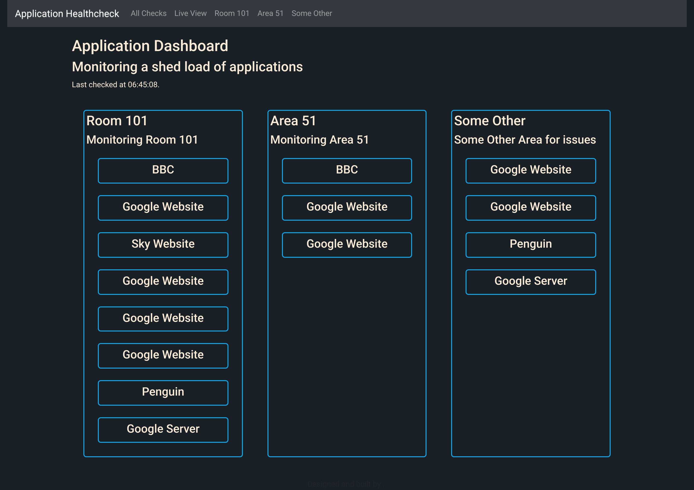
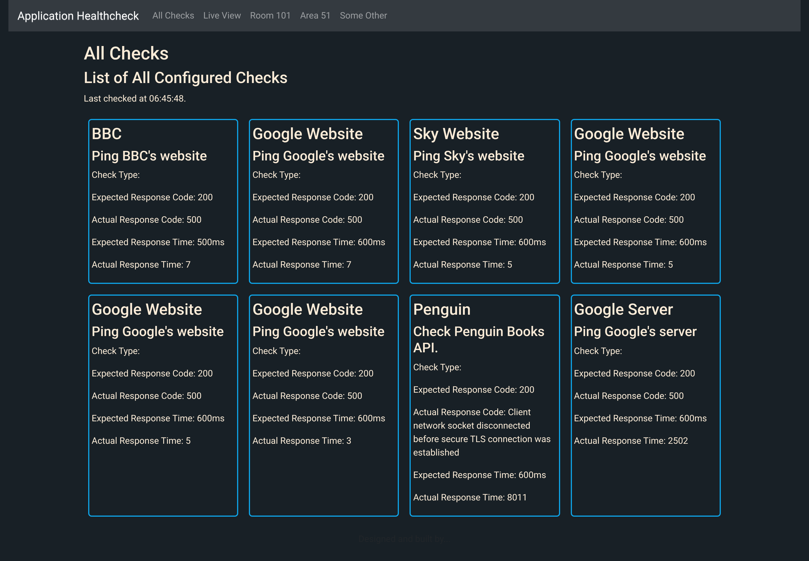
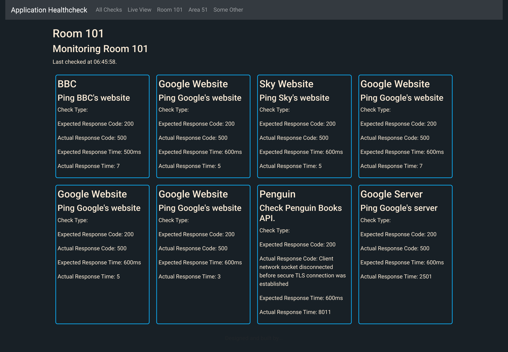

# Application Healthcheck

A Node.js + React dashboard for monitoring websites, web services, and servers.

It periodically runs configured checks, exposes results over a simple REST API and Socket.IO, and provides a React front-end for viewing status.

## Features

- Website (HTTP) and web-service checks via Axios
- Server reachability checks via TCP connect (no raw-socket privileges required)
- Configurable check interval
- Landscape / asset grouping
- Live updates over Socket.IO
- Structured logging (Winston + daily rotate)

## Requirements

- Node.js 18+ recommended
- npm

## Quick start

```bash
npm install
npm run develop
```

The API listens on the port defined in `config/development.json` (default 5251).

Build the client separately if needed:

```bash
npm run client:develop
# or produce a production build with Parcel into dist/
```

Then open `http://localhost:5251`.


## Screenshots

Home dashboard, the full checks list, and a landscape monitor view:







## Configuration

Edit `config/development.json` (or `config/test.json`).

Key sections:

- `healthcheck.options` – port, log folders, `checkIntervalMs` (default 300000)
- `healthcheck.items` – list of assets to check
- `healthcheck.appLandscapes` – grouping of item keys

Each item requires at least:

- `key` (number)
- `name`
- `checkType` (`website` | `webservice` | `server`)
- `url`

Optional for web services: `method`, `headers`, `payload`.

For server checks the URL may be `host` or `host:port` (defaults to port 80).

## API examples

- `GET /api/assets/list`
- `GET /api/assets/check/all/`
- `GET /api/assets/check/id/:id`
- `GET /api/landscapes/list`

## Known limitations

- Check endpoints have no authentication or rate limiting. Do not expose the service publicly without additional protection.
- Results are logged but not persisted in a database.
- The front-end expects a built client in `dist/`.

## Development

```bash
npm test
npm run test:coverage
```

## Contributing

1. Fork the repo
2. Create a feature branch
3. Keep changes small and focused
4. Run tests
5. Open a pull request with a clear description

## License

ISC
